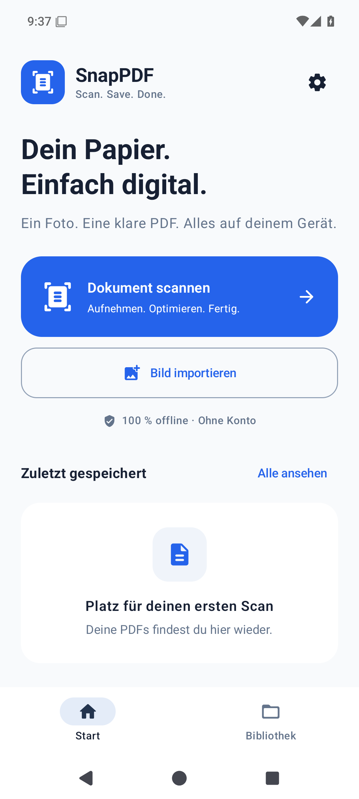
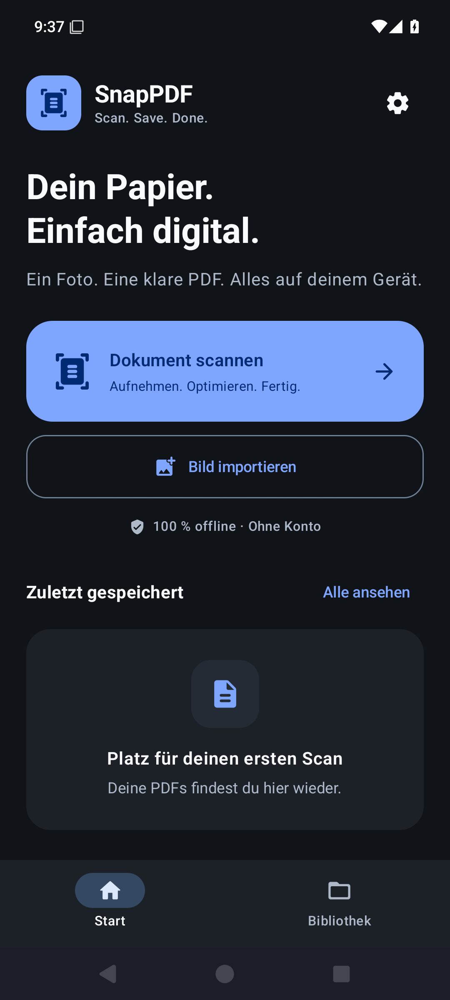

# SnapPDF

**Scan. Save. Done.**

Eine native Android-App für schnelle Dokumentenscans: fotografieren oder Bilder importieren, Papier entzerren, Schrift optimieren und eine mehrseitige PDF lokal speichern. Kotlin, Jetpack Compose und Material 3; Android 8.0 oder neuer (API 26).

## APK installieren

Die signierte Android-APK und ihre SHA-256-Prüfsumme stehen unter [GitHub Releases](https://github.com/lavender1510/SnapPDF/releases). Benötigt wird Android 8.0 oder neuer. APK auf dem Smartphone öffnen und die Installation aus dieser Quelle erlauben. Nach der Installation ist keine Internetverbindung nötig; das OCR-Modell ist bereits enthalten.

Die erste Version ist eine Vorabversion. Tests mit physischen Smartphone-Kameras und unterschiedlichen echten Schulhandschriften stehen noch aus; die durchgeführten Prüfungen sind in [TESTING.md](docs/TESTING.md) dokumentiert.

## Einblicke

Aufnahmen der tatsächlich installierten App; keine Entwurfsbilder.

<p>
  
  
</p>

Die [helle](docs/screenshots/editor-real-photo-light.png) und [dunkle Scanvorschau](docs/screenshots/editor-real-photo-dark.png) zeigen das gekennzeichnete echte OpenCV-Testfoto.

## Benutzung

1. **Dokument scannen** öffnet die Kamera. Beim ersten Start die Kameraberechtigung erlauben.
2. Das Blatt möglichst vollständig und ruhig aufnehmen. Weitere Seiten lassen sich in derselben Sitzung fotografieren. Alternativ **Bild importieren** für vorhandene Fotos verwenden.
3. In der Vorschau bei Bedarf Ecken, Drehung, Scanmodus und Kontrast korrigieren. Bei schwacher Bleistiftschrift zuerst **Handschrift** ausprobieren.
4. Seiten prüfen und als PDF speichern. Die Bibliothek bietet Öffnen, Teilen und den Export über die Android-Dateiauswahl.

Erstellte PDFs bleiben in der lokalen Bibliothek. Eine Kopie außerhalb der App über **Exportieren** oder einen gewählten Speicherordner sichern; Android entfernt appinterne Dateien bei einer Deinstallation.

## Funktionen

- CameraX-Kamera mit Dokumentenkanten, Autofokus, Blitz und optionaler automatischer Aufnahme.
- Automatischer oder manueller Zuschnitt und Perspektivkorrektur mit OpenCV.
- Drei Bildmodi: Standard, Handschrift und hoher Kontrast; einstellbare Intensität.
- Mehrseitige Scans, Seiten drehen, löschen, ergänzen und umordnen.
- Bildimport über den Android Photo Picker, einschließlich Mehrfachauswahl.
- Lokaler PDF-Export mit A4, A5 oder automatischem Seitenformat und drei Qualitätsstufen.
- Dokumentenbibliothek mit Vorschaubildern, Suche, Sortierung, Ordnern und PDF-Zusammenführung.
- Optionales, mitgeliefertes OCR-Modell für gedruckten deutschen und englischen Text sowie eine durchsuchbare Textebene im PDF.
- Helles und dunkles Design, Systemdarstellung sowie optionale dynamische Farben ab Android 12.
- Lokale Scanentwürfe zur Wiederaufnahme nach einem App-Neustart und eine Scanner-App-Verknüpfung.

Automatische Erkennung und OCR können fehlschlagen. Ecken vor dem Speichern kontrollieren; schwer lesbare Handschrift wird von der OCR nicht zuverlässig erkannt. Die lesbare Bildseite bleibt auch ohne OCR erhalten. Einzelheiten zur technischen Umsetzung und den Qualitätsgrenzen stehen in [ARCHITECTURE.md](docs/ARCHITECTURE.md).

## Datenschutz

Die App benötigt kein Konto und deklariert keine Internetberechtigung. Kamera, Erkennung, Optimierung, PDF-Erzeugung, OCR und Bibliothek arbeiten lokal. Das OCR-Modell und die OpenCV-Bibliotheken sind Bestandteil der APK; ein Modelldownload beim ersten Scan ist nicht erforderlich.

Die Kameraberechtigung wird ausschließlich für Aufnahmen angefragt. Fotos werden über den Systempicker ausgewählt, Dateien über das Storage Access Framework exportiert; eine allgemeine Speicherberechtigung ist nicht erforderlich. Ein vom Nutzer gewählter Cloud-Dateianbieter oder eine empfangende Teilen-App kann Daten selbst übertragen. SnapPDF lädt Dokumente nicht automatisch hoch.

## Projekt bauen

Benötigt werden ein vollständiges **JDK 17 oder 21**, Android SDK **Platform 35**, **Build Tools 35.0.0** und eine Internetverbindung zum erstmaligen Herunterladen der Build-Abhängigkeiten. Android Studio kann SDK und JDK bereitstellen. Die fertige App benötigt keine Netzwerkverbindung.

```bash
git clone https://github.com/lavender1510/SnapPDF.git
cd SnapPDF
# Android Studio legt local.properties mit sdk.dir an.
# Für die Kommandozeile alternativ ANDROID_HOME auf das lokale SDK setzen.
./gradlew testDebugUnitTest lintDebug assembleDebug
```

Die installierbare Entwicklungs-APK liegt unter `app/build/outputs/apk/debug/app-debug.apk`.

```bash
adb install -r app/build/outputs/apk/debug/app-debug.apk
```

Das Projekt verwendet Gradle **8.9**, Android Gradle Plugin **8.7.3** und Kotlin **2.0.21**. Der Gradle Wrapper legt die Gradle-Version fest. `local.properties`, lokale Schlüssel und Build-Ergebnisse gehören nicht ins Repository.

Zentrale Laufzeitbibliotheken sind CameraX **1.4.1**, OpenCV **4.12.0**, Room **2.6.1**, das gebündelte ML-Kit-Latin-Modell **16.0.1** und PDFBox Android **2.0.27.0**. Die genauen Versionen stehen in `app/build.gradle.kts`.

### Signierte Release-APK

Für aktualisierbare Releases muss derselbe private Signierschlüssel sicher aufbewahrt werden. Ein eigener Schlüssel kann mit `keytool -genkeypair` erzeugt werden. Die vier folgenden Variablen aktivieren die Release-Signierung:

```bash
export SNAPPDF_KEYSTORE=/absoluter/pfad/snappdf-release.jks
export SNAPPDF_KEY_ALIAS=snappdf
# Die beiden Passwörter über eine sichere lokale Secret-Verwaltung setzen:
# SNAPPDF_STORE_PASSWORD und SNAPPDF_KEY_PASSWORD
./gradlew assembleRelease
```

Die signierte APK liegt anschließend unter `app/build/outputs/apk/release/app-release.apk`. Ohne konfigurierte Signierung ist eine erzeugte `*-unsigned.apk` kein installierbares Release. Vor der Veröffentlichung Signatur und Prüfsumme kontrollieren:

```bash
"$ANDROID_HOME/build-tools/35.0.0/apksigner" verify --verbose \
  app/build/outputs/apk/release/app-release.apk
sha256sum app/build/outputs/apk/release/app-release.apk
```

Der [GitHub-Workflow](.github/workflows/android.yml) prüft Unit-Tests, Android Lint und den Debug-Build. Für einen zusätzlichen signierten Build bei einem Versions-Tag oder einem manuellen Workflow-Start werden Repository-Secrets `SNAPPDF_KEYSTORE_BASE64`, `SNAPPDF_STORE_PASSWORD`, `SNAPPDF_KEY_ALIAS` und `SNAPPDF_KEY_PASSWORD` benötigt. Fehlen sie, veröffentlicht die CI keine Release-APK. Der Workflow erstellt selbst keinen GitHub-Release.

## Verifizierter Stand

4 JVM- und 24 native Android-Tests bestehen. Die signierte Produktions-APK wurde zusätzlich auf Android 15 installiert und gestartet. [Nachweise, Prüfsumme und offene Hardware-Abnahme](docs/VERIFICATION.md).

## Struktur und Tests

```text
app/src/main/java/de/snappdf/
  data/        Modelle, Einstellungen, Room, PDF und lokale Entwürfe
  processing/  Dokumentenerkennung, Bildoptimierung und OCR
  scanner/     CameraX und manuelle Eckenkorrektur
  ui/          Compose-Oberflächen und Designsystem
```

[ARCHITECTURE.md](docs/ARCHITECTURE.md) erläutert Datenfluss und wichtige Entscheidungen. [TESTING.md](docs/TESTING.md) enthält automatisierte Prüfungen, reale Testfälle und den Verifikationsstand. Die dort getrennt ausgewiesenen Gerätetests dürfen durch einen erfolgreichen Build nicht als erledigt gelten.
