# Architektur

SnapPDF ist eine lokale Android-Anwendung mit Kotlin und Jetpack Compose. Die UI beobachtet Zustände; länger laufende Bild- und Dateioperationen erfolgen über Coroutines außerhalb des UI-Threads. Das Projekt ist nach Verantwortlichkeiten in Pakete gegliedert, damit die kleine Anwendung ohne zusätzliche Modulgrenzen verständlich bleibt.

## Scanablauf

```mermaid
flowchart LR
    A[CameraX oder Photo Picker] --> B[Original im lokalen Sitzungsverzeichnis]
    B --> C[EXIF-Ausrichtung und begrenzte Dekodierung]
    C --> D[Dokumentenerkennung oder manuelle Ecken]
    D --> E[Perspektivkorrektur und Bildmodus]
    E --> F[Persistierter Scanentwurf]
    F --> G[Mehrseitige Vorschau]
    G --> H[Optionales lokales OCR]
    H --> I[PDF und lokale Bibliothek]
    I --> J[SAF-Export oder Android Sharesheet]
```

`ScanSession` enthält die geordneten `ScanPage`-Einträge. Eine Seite verweist auf das erhaltene Original und ein verarbeitetes Bild. Mode, Intensität, vier normierte Ecken und Drehung werden als Bearbeitungsparameter gespeichert. Korrekturen werden vom Original abgeleitet, damit wiederholte Änderungen nicht von bereits komprimierten Vorschauen abhängen.

## Kamera und Ecken

CameraX stellt Vorschau, Analyse und Aufnahme bereit. Die Analyse arbeitet mit kleineren Bildern, während die eigentliche Aufnahme höher aufgelöst verarbeitet wird. `DocumentProcessor.detect` liefert ein Viereck, eine heuristische Erkennungssicherheit sowie Werte für Helligkeit und Schärfe. Die Vorschau zeichnet die Ecken in demselben ausgerichteten Koordinatensystem.

OpenCV sucht nach einem hinreichend großen, plausiblen Dokumentviereck. Eine projektive Transformation entzerrt das gefundene oder manuell gesetzte Viereck. Bei fehlender zuverlässiger Erkennung bleibt die vollständige Aufnahme verfügbar. Eine Erkennungssicherheit ist keine Garantie, dass jeder Inhalt vollständig erfasst wurde; besonders randlose Blätter auf hellem Untergrund und verdeckte Papierkanten benötigen eine manuelle Kontrolle.

EXIF-Orientierung wird beim Laden berücksichtigt. Zusätzliche Seitendrehungen sind eine Benutzeraktion. Die App verspricht keine semantisch zuverlässige Erkennung der Leserichtung beliebiger handschriftlicher Blätter.

## Bildverarbeitung

`processing/DocumentProcessor.kt` kapselt die native OpenCV-Verarbeitung und lokale ML-Kit-Texterkennung. Bitmap-Größen werden beim Dekodieren begrenzt; native Matrizen und Bitmaps werden nach Gebrauch freigegeben. Eine Seite wird unabhängig von den anderen verarbeitet, sodass mehrseitige Dokumente keine Liste aller voll aufgelösten Bitmaps im Speicher benötigen.

Die Optimierung berücksichtigt lokale Beleuchtung und setzt adaptive Verfahren zur Schriftverstärkung ein. Standard priorisiert ein ausgewogenes Ergebnis. Handschrift verwendet einen empfindlicheren lokalen Schwellwert für schwächere Striche und kann deshalb mehr Hintergrundrauschen stehen lassen. Alle drei Modi erzeugen binäre Schwarz-Weiß-Bilder. Hoher Kontrast priorisiert einen weißen Hintergrund und dunkle gedruckte Schrift. Der Intensitätsregler verändert die Verarbeitung; er kann fehlende oder im Foto bereits verwischte Striche nicht wiederherstellen.

Tests mit synthetischen Schatten, schwachen Linien und perspektivischen Seiten prüfen Grundverhalten. Sie ersetzen keine Prüfung mit echten Schulkopien, Bleistift und unterschiedlichen Kameras.

## OCR und durchsuchbares PDF

Das mitgelieferte Latin-Modell von ML Kit arbeitet ohne Netzwerk und erkennt insbesondere gedruckten Text in deutscher und englischer Sprache. OCR ist optional und gehört nicht zur Live-Kameraanalyse. Die verarbeiteten Seiten werden erkannt; `OcrLine` speichert Text sowie normierte Zeilenrechtecke.

Die PDF-Seite enthält das lesbare Scanbild. Zusätzlicher OCR-Text wird als unsichtbare Textebene positioniert. PDF-Reader können ihn suchen, auswählen und kopieren; Lesereihenfolge und Treffergenauigkeit hängen vom Erkennungsergebnis ab. Das Bild wird durch OCR nicht ersetzt. Handschrift, komplexe Formeln und Tabellenstruktur werden nicht verlässlich als strukturierte Inhalte rekonstruiert. Die PDF-Textebene verwendet WinAnsi; unterstützte deutsche und englische Zeichen bleiben erhalten, nicht darstellbare Zeichen werden dort durch Leerzeichen ersetzt. Die sichtbare Bildseite und der lokal gespeicherte OCR-Suchtext werden dadurch nicht verändert.

## PDFs und Bibliothek

`DocumentRepository` kapselt Room-Metadaten und lokale Dateien. `DocumentEntity` enthält Titel, Zeitstempel, Seitenzahl, Dateipfade, Größe, optionalen Ordner und Suchtext. `FolderEntity` beschreibt die einfache Ordnerzuordnung. Originale und verarbeitete Sitzungsbilder liegen im internen App-Speicher; freigegebene PDF-Dateien werden über einen `FileProvider` mit zeitlich begrenzter Leseberechtigung weitergegeben.

PDFBox Android erzeugt und vereinigt PDFs auf dem Gerät. Automatisches Seitenformat folgt dem Seitenverhältnis, A4 und A5 skalieren den Inhalt mit korrektem Seitenverhältnis auf das Papier. Die Qualitätswahl begrenzt die längste Bildkante auf 1700 Pixel (Kompakt), 2600 Pixel (Standard) oder bis zu 3600 Pixel (Hoch); die vorgelagerte Scanverarbeitung liefert höchstens 3000 Pixel. Quellen werden nicht hochskaliert. Verarbeitete Seiten werden verlustfrei komprimiert eingebettet. Mehrseitige Exporte verarbeiten die Seiten nacheinander. Eine PDF-Zusammenführung benötigt die vorhandenen lokalen PDF-Dateien, keine erneute Kameraverarbeitung.

Die lokale Speicherung und ein anschließender SAF-Export sind getrennte Schritte. Scheitert eine externe Kopie, bleibt das erfolgreich lokal gespeicherte Dokument erhalten. Der Storage Access Framework-Zugriff verwendet die explizite Ordnerfreigabe des Nutzers und darf keine vorhandene gleichnamige Datei unbemerkt überschreiben.

## Entwürfe und Fehler

Ein Sitzungsentwurf enthält Dateiverweise und Seitenparameter. Er wird im persistenten App-Speicher statt nur im Cache gehalten. Erfolgreiche Seiten können so nach einem Prozessabbruch erneut geladen werden. Eine zum Zeitpunkt des Abbruchs noch nicht abgeschlossene Aufnahme oder Schreiboperation kann nicht als erfolgreich gesicherte Seite gelten.

Erst eine erfolgreiche PDF-Speicherung oder ein ausdrückliches Verwerfen darf den zugehörigen Entwurf entfernen. Temporärdateibereinigung muss den aktuellen Entwurf schützen. Beschädigte Bilder, fehlende Berechtigungen, fehlende Kamera und Schreibfehler werden an der UI sichtbar gemeldet. Bei Speicherplatzmangel lässt sich ein Export erst nach dem Freigeben von Platz abschließen.

## Einstellungen und Android-Integration

`SettingsStore` veröffentlicht `AppSettings` als `StateFlow`. Einstellungen sind in Allgemein, Scanner, PDF und Datenschutz gegliedert. Systemdarstellung, Light/Dark und optionale dynamische Material-You-Farben werden beim Rendern angewendet. Android Photo Picker und SAF vermeiden eine allgemeine Speicherberechtigung. Die Scanner-Verknüpfung öffnet denselben nativen Aufnahmeablauf wie der Startbildschirm.

Die reduzierte Bewegung wirkt über einen `MotionDurationScale` im Compose-Coroutine-Kontext. Der öffentliche Compose-Factory `createLifecycleAwareWindowRecomposer` erhält die übliche Android-Lebenszyklussteuerung und schaltet lediglich die Animationsdauer auf null. Wird die Option deaktiviert, gilt wieder der schreibgeschützt beobachtete Systemwert. Die Beobachtung läuft nur während einer sichtbaren Activity; globale Android-Einstellungen werden nicht verändert.

Es gibt keine Anmeldung, Telemetrie oder Serverkomponente. Die Anwendung deklariert keine Internetberechtigung. Vom Nutzer bewusst ausgewählte externe Android-Apps und Dokumentanbieter unterliegen deren eigenen Datenschutzbedingungen.

